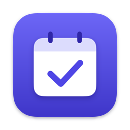
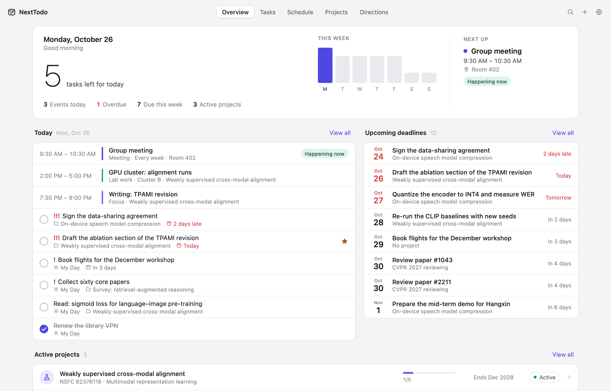
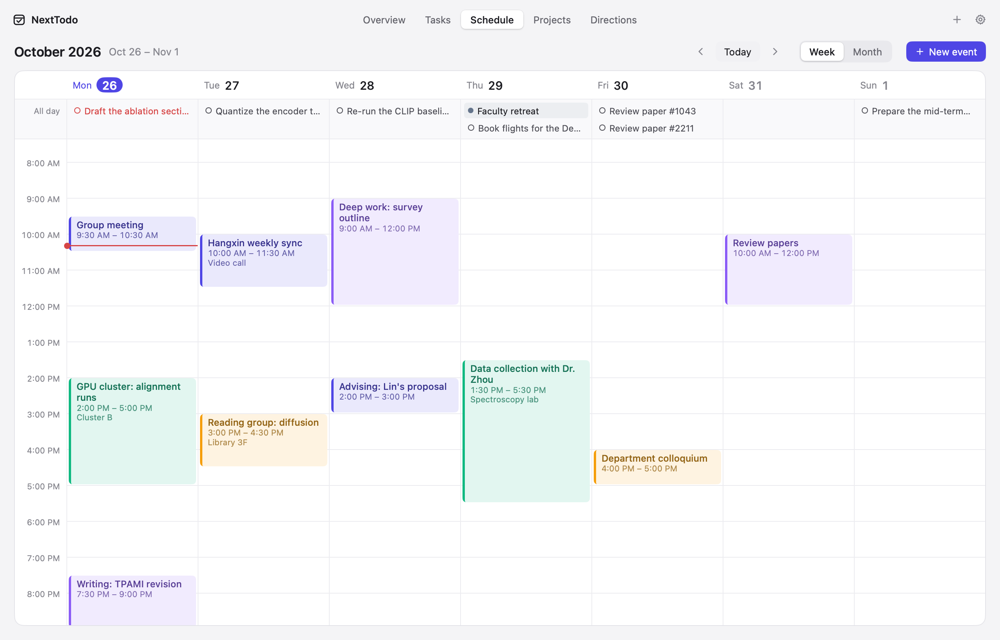
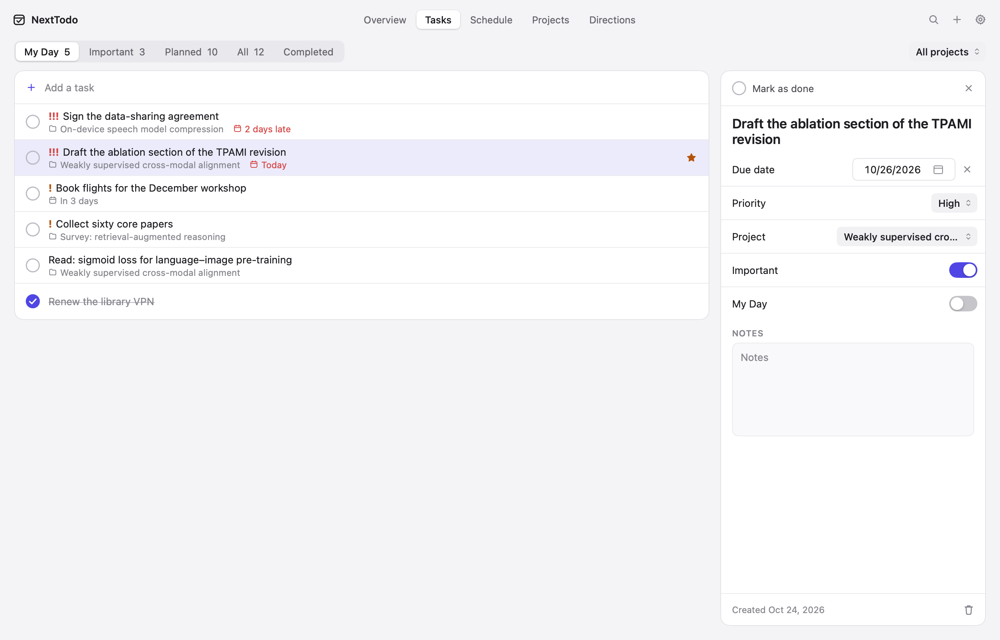
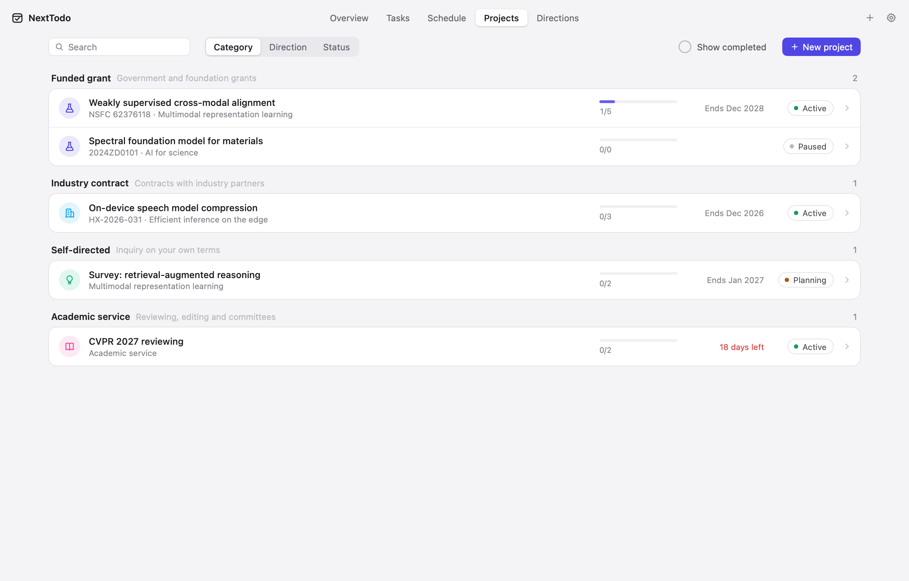
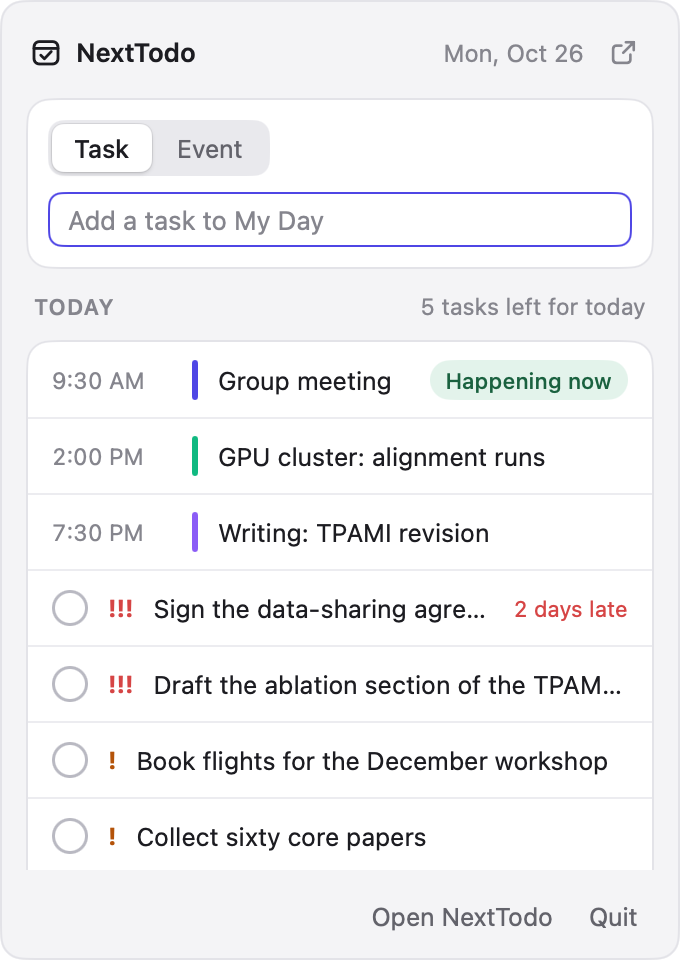
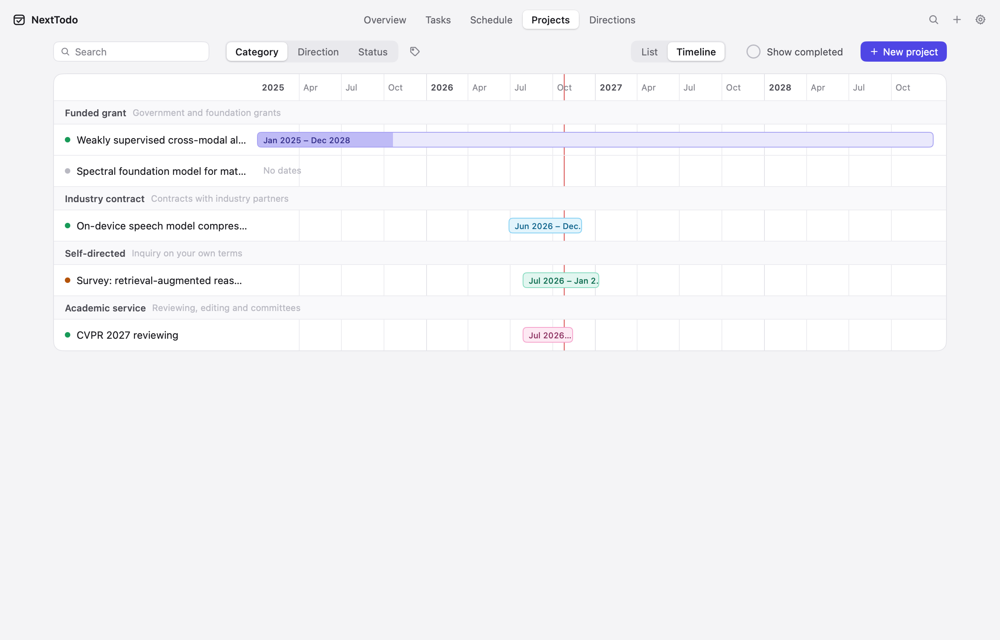

<p align="center">
  
</p>

<h1 align="center">NextTodo</h1>

<h3 align="center">Your research, planned. On your Mac.</h3>

<p align="center">
  <b>Schedules, tasks and projects in one quiet app,<br>sorted the way you think about your work.</b>
</p>

<p align="center">
  
  
  
  
  
</p>

<p align="center">
  <b><a href="../../releases/latest">Download</a></b> &nbsp;·&nbsp;
  <b><a href="#build-from-source">Build from source</a></b> &nbsp;·&nbsp;
  <b>English</b> · <a href="README.zh-CN.md">简体中文</a>
</p>

<picture>
  <source media="(prefers-color-scheme: dark)" srcset="docs/img/overview-dark.png">
  
</picture>

## Is NextTodo for you?

A research life lives in too many places: grants in a spreadsheet, meetings in a calendar, to-dos in another app, and the notes on how an experiment went nowhere at all. NextTodo keeps them together, on your Mac:

- **Projects, sorted your way.** Make your own categories (by funding, by lab, by anything) with a color and an icon, or group by research direction or status; see them as a list or on a timeline. Each project keeps its tasks, events, dated journal and particulars (grant number, lead, funder, dates) in one place, and goes to the archive when it ends.
- **A calendar that moves with you.** Week and month views, tags of your own, events that repeat, drag to reschedule, to sketch a new one or to block time for a task, a notification before each event starts, and .ics import and export to get along with Calendar, Google and Outlook.
- **Today, from the menu bar.** What is left of the day, and a field to add a task or an event, one click or ⌃⌥Space away.
- **Yours, offline.** No account, no cloud. One JSON file in your Library, saved as you type, copied every day, with Undo for every deletion.

It's for you if you juggle more than one project and more than one kind of commitment. If one list of to-dos is enough, Reminders will do.

English and 简体中文. Light and dark.

## Features

<table>
  <tr>
    <td width="50%">
      <picture>
        <source media="(prefers-color-scheme: dark)" srcset="docs/img/schedule-dark.png">
        
      </picture>
      <p><b>Schedule.</b> Drag an event to move it, in whole days and quarter hours; drag its bottom edge to resize it; drag down empty hours to add one, or a task into the hours to block time for it. Events repeat daily, on weekdays, weekly or monthly. In the month, drag events and due tasks between days.</p>
    </td>
    <td width="50%">
      <picture>
        <source media="(prefers-color-scheme: dark)" srcset="docs/img/tasks-dark.png">
        
      </picture>
      <p><b>Tasks.</b> My Day gathers what you planned for today and what is due or late. Important, Planned (by day, as in Reminders), All and Completed, with priorities, due dates, notes and projects. ↑↓ to choose, ⌘K to finish.</p>
    </td>
  </tr>
  <tr>
    <td width="50%">
      <picture>
        <source media="(prefers-color-scheme: dark)" srcset="docs/img/projects-dark.png">
        
      </picture>
      <p><b>Projects.</b> Grouped by your categories, direction or status, each with its progress and when it ends. Or see them on a timeline, over the months they run. Open one for its summary, tasks, research journal and upcoming events; archive it when it's done.</p>
    </td>
    <td width="50%" align="center">
      <picture>
        <source media="(prefers-color-scheme: dark)" srcset="docs/img/panel-dark.png">
        
      </picture>
      <p><b>Menu bar.</b> Today's events and tasks, checked off where they are, and a field that adds a task to My Day or an event today.</p>
    </td>
  </tr>
  <tr>
    <td colspan="2">
      <picture>
        <source media="(prefers-color-scheme: dark)" srcset="docs/img/timeline-dark.png">
        
      </picture>
      <p><b>Timeline.</b> Every project over the months it runs, in its category's color, filled as far as its tasks are done, with a line at today: which grant ends when, and what overlaps.</p>
    </td>
  </tr>
</table>

And: type the day and the time with what you add ("Seminar fri 3-4pm", "明天下午3点 组会"), reminders for tasks, search everything with ⌘F, research directions with their projects, reminders before events (a default and one per event), a Dock badge for what is due, open at login, ⌘1–⌘5 for the pages, daily backups you can restore, and sample data on first launch to show the way.

## Quick start

**1 · Install.** Download the disk image from [Releases](../../releases/latest), open it and drag NextTodo to Applications. The build is signed ad hoc: the first time, right-click the app and choose Open.

**2 · Plan today.** Add tasks to My Day, events to the week, and let the reminders come. The menu bar icon keeps today one click away.

**3 · Sort your projects.** Create a project for each grant, contract or line of inquiry, give it a direction, and its tasks and events follow it everywhere.

Your data is in `~/Library/Application Support/NextTodo/data.json`. Export a backup from Settings › Data.

## How it's built

NextTodo is written in Go with [MyGo](https://mygo.egoist.dev/)'s native UI: no HTML, no JavaScript, no webview. MyGo draws every frame on the GPU with Metal and lays out text with Core Text, so the app opens at once, idles at 0% CPU, and ships as a 10 MB app in a 3 MB disk image. Its look follows [magpie](https://github.com/yetone/magpie): a soft gray window, white cards with hairline edges, SF Pro and one indigo accent.

| | |
|---|---|
| `store.go` | the data, its file and backups, queries and dates |
| `style.go`, `icons.go`, `art.go` | the palette, the components, the icons |
| `app.go` | the app's state, saving, the title bar |
| `overview.go`, `tasks.go`, `schedule.go`, `projects.go`, `directions.go`, `settings.go` | the pages |
| `repeat.go`, `ics.go` | events that repeat, and calendar files |
| `parse.go` | the day and the time in what is typed |
| `timeline.go` | the projects over the months they run |
| `categories.go`, `search.go`, `undo.go`, `backups.go` | categories, search, Undo, daily copies |
| `panel.go`, `alerts.go` | the menu bar panel, and when events alert |
| `locales/` | every string, in English and Chinese |

## Build from source

Go 1.27 or later. In mainland China, `go env -w GOPROXY=https://goproxy.cn,direct` first.

```sh
git clone https://github.com/yuxiaoLeeMarks/nexttodo.git && cd nexttodo
go tool mygo dev      # run, reloading as you edit
go test ./...         # the tests drive every view without a window
go tool mygo build    # build/darwin-arm64/NextTodo.app and its .dmg
go tool mygo build -platform darwin/universal   # for Apple silicon and Intel
```

`NT_SNAPSHOTS=/tmp/shots go test -run TestSnapshots .` renders every page, light and dark, in both languages. Strings live in `locales/en.json` and `locales/zh-Hans.json`.

## License

[MIT](LICENSE)
