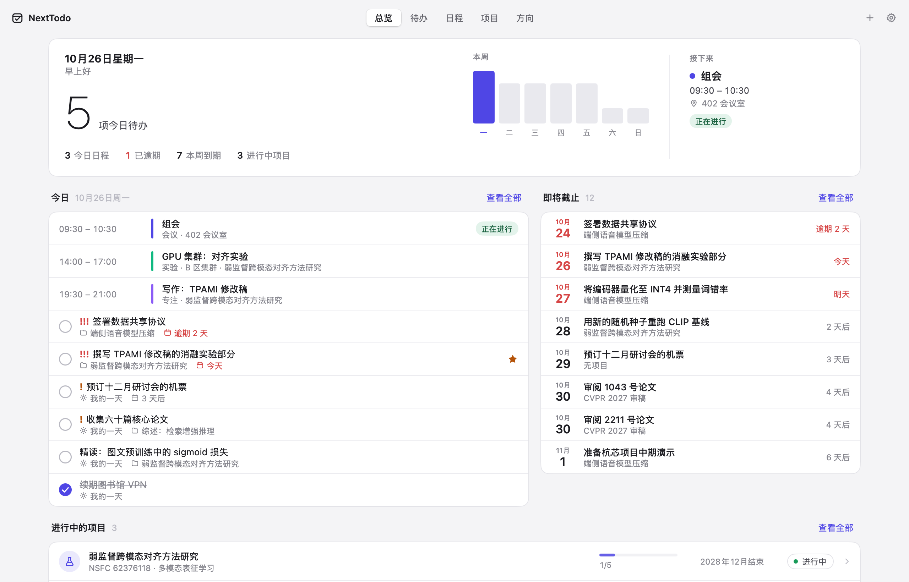

<p align="center">
  
</p>

<h1 align="center">NextTodo</h1>

<h3 align="center">科研，有条不紊。就在你的 Mac 上。</h3>

<p align="center">
  <b>日程、待办与科研项目，放进一个安静的应用，<br>按你自己的方式归类。</b>
</p>

<p align="center">
  
  
  
  
  
</p>

<p align="center">
  <b><a href="../../releases/latest">下载</a></b> &nbsp;·&nbsp;
  <b><a href="#从源码构建">从源码构建</a></b> &nbsp;·&nbsp;
  <a href="README.md">English</a> · <b>简体中文</b>
</p>

<picture>
  <source media="(prefers-color-scheme: dark)" srcset="docs/img/overview-zh-dark.png">
  
</picture>

## NextTodo 适合你吗？

科研生活散落在太多地方：课题在表格里，会议在日历里，待办在另一个应用里，实验的心得则无处安放。NextTodo 把它们放回同一个地方，留在你的 Mac 上：

- **项目，按你的方式归类。** 自定义类别（按经费来源、按课题组，随你），配上颜色与图标；也可按研究方向或状态分组，以列表或时间线查看。每个项目的任务、日程、研究日志与项目信息（编号、负责人、资助方、起止日期）都集中在一处，结束后一键归档。
- **跟得上你的日历。** 周视图与月视图，自定义日程标签，支持重复日程，拖拽即可改期、划出新日程或为待办预留时间，日程开始前推送系统通知，可导入导出 .ics，与系统日历、Google、Outlook 互通。
- **今日安排，就在菜单栏。** 今天还剩什么，以及一个添加待办或日程的输入框，点一下或按 ⌃⌥空格 即达。
- **数据属于你，离线可用。** 无需账号，不上云。数据是资源库中的一个 JSON 文件，随写随存，每天自动备份，删除皆可撤销。

如果你同时推进不止一个项目、不止一类事务，它适合你。如果一张待办清单就够了，系统自带的「提醒事项」足矣。

支持 English 与简体中文，浅色与深色。

## 功能

- **日程**：拖动日程改期（按整天与 15 分钟对齐），拖动下边缘调整时长，在空白时段向下拖动即可新建，把待办拖进时段即可为它预留一小时；日程可按每天、工作日、每周、每两周或每月重复，可单独修改某一次；月视图中可在日期之间拖动日程与到期待办。
- **待办**：「我的一天」汇集今天计划的、今天到期的和已逾期的待办；另有重要、已计划（像「提醒事项」一样按日期分组）、全部、已完成，支持优先级、截止日期、备注与所属项目；↑↓ 选择，⌘K 完成。
- **项目**：按自定义类别、方向或状态分组，显示进度与结束日期；项目页包含概述、任务、研究日志与近期日程；也可切换为时间线，按起止月份查看全部项目；项目结束后可归档，随时恢复。
- **菜单栏**：今日的日程与待办可直接勾选完成，输入框可添加到「我的一天」或添加今天的日程。
- 还有：添加时直接写日期与时间（「组会 周五下午3点到4点」「Review draft tomorrow」）、待办提醒、⌘F 全局搜索、研究方向与其项目、日程提醒（默认提前时间与单个日程的提醒）、程序坞角标、登录时打开、⌘1–⌘5 切换页面、可恢复的每日备份；首次启动是干净的，欢迎页告诉你从哪里开始，想先看看效果也可一键载入示例数据。

## 快速开始

**1 · 安装。** 从 [Releases](../../releases/latest) 下载磁盘映像，打开后把 NextTodo 拖入「应用程序」。NextTodo 暂未经过 Apple 公证，首次打开时 macOS 会提示无法打开：点「完成」，再双击磁盘映像窗口中的 **Privacy & Security**（隐私与安全性），下滑到「安全性」，在 NextTodo 旁点 **仍要打开**。只需一次。（也可在终端运行：`xattr -dr com.apple.quarantine /Applications/NextTodo.app`）

**2 · 规划今天。** 把待办加入「我的一天」，把日程放进本周，提醒会按时到来。菜单栏图标让今天的安排随时可见。

**3 · 整理项目。** 为每个课题、合同或研究线索建一个项目，指定研究方向，它的任务与日程会随处跟随。

数据位于 `~/Library/Application Support/NextTodo/data.json`，可在「设置 › 数据」中导出备份。

## 实现

NextTodo 使用 Go 与 [MyGo](https://mygo.egoist.dev/) 的原生界面编写：没有 HTML、没有 JavaScript、没有 WebView。MyGo 用 Metal 在 GPU 上绘制每一帧，用 Core Text 排版文字，因此应用即开即用、空闲时 CPU 占用为 0，应用体积 10 MB，安装包 3 MB。界面风格参照 [magpie](https://github.com/yetone/magpie)：柔和的灰色窗口、带细边的白色卡片、SF Pro 字体与一抹靛蓝。

## 从源码构建

需要 Go 1.27 及以上。中国大陆请先执行 `go env -w GOPROXY=https://goproxy.cn,direct`。

```sh
git clone https://github.com/yuxiaoLeeMarks/nexttodo.git && cd nexttodo
go tool mygo dev      # 运行，编辑后自动重载
go test ./...         # 测试在无窗口的情况下驱动每个界面
go tool mygo build    # 生成 build/darwin-arm64/NextTodo.app 与 .dmg
go tool mygo build -platform darwin/universal   # 同时支持 Apple 芯片与 Intel
```

## 许可证

[MIT](LICENSE)
