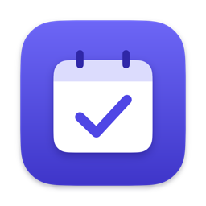
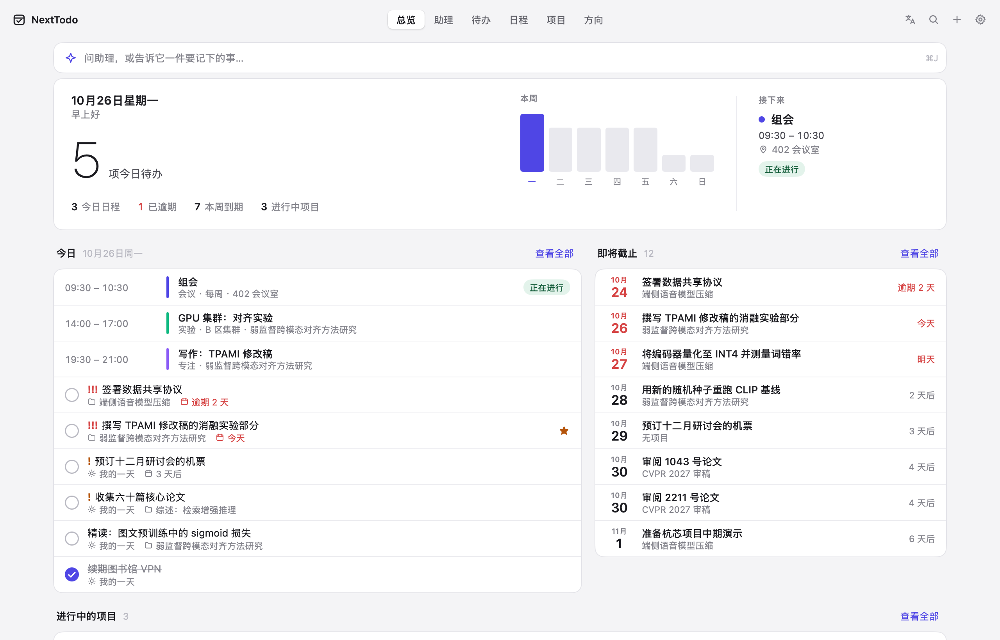
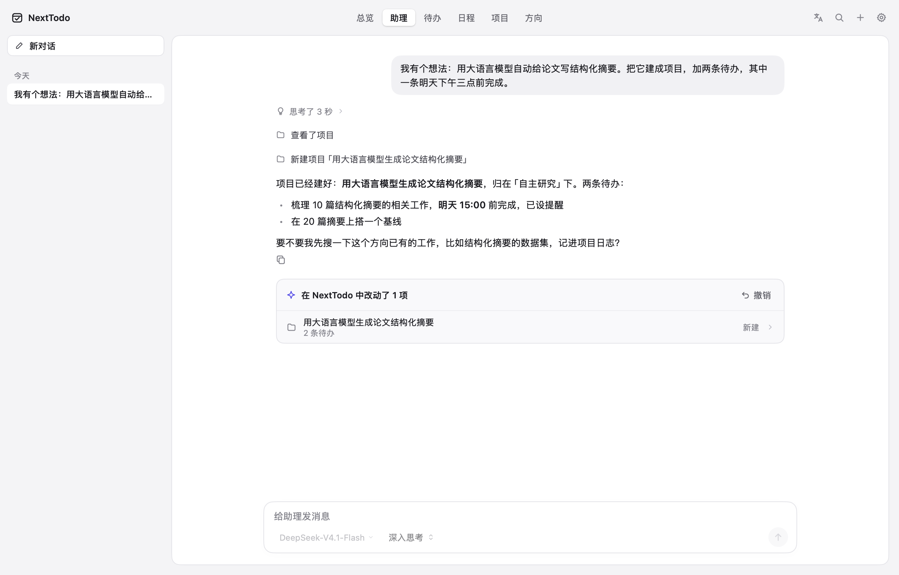
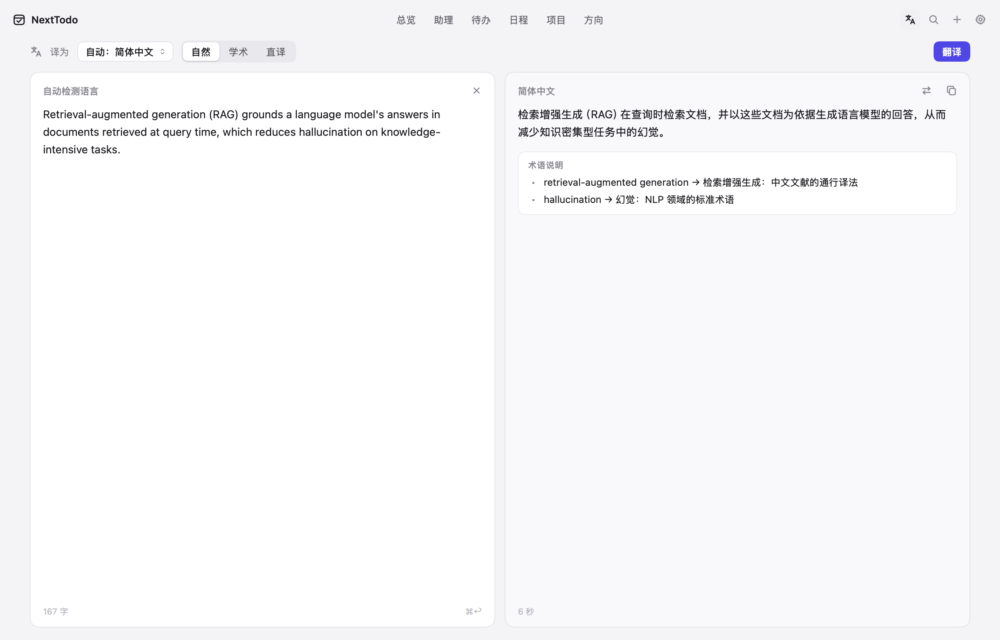

<p align="center">
  
</p>

<h1 align="center">NextTodo</h1>

<h3 align="center">科研，有条不紊。就在你的 Mac 上。</h3>

<p align="center">
  <b>日程、待办与科研项目，放进一个安静的应用，<br>还有一位替你打理它们的助理。</b>
</p>

<p align="center">
  
  
  
  
  
</p>

<p align="center">
  <b><a href="../../releases/latest">下载</a></b> &nbsp;·&nbsp;
  <b><a href="#从源码构建">从源码构建</a></b> &nbsp;·&nbsp;
  <a href="README.md">English</a> · <b>简体中文</b>
</p>

<picture>
  <source media="(prefers-color-scheme: dark)" srcset="docs/img/overview-zh-dark.png">
  
</picture>

## NextTodo 适合你吗？

科研生活散落在太多地方：课题在表格里，会议在日历里，待办在另一个应用里，实验的心得则无处安放。NextTodo 把它们放回同一个地方，留在你的 Mac 上：

- **项目，按你的方式归类。** 自定义类别（按经费来源、按课题组，随你），配上颜色与图标；也可按研究方向或状态分组，以列表或时间线查看。每个项目的任务、日程、研究日志与项目信息（编号、负责人、资助方、起止日期）都集中在一处，结束后一键归档。
- **跟得上你的日历。** 周视图与月视图，自定义日程标签，支持重复日程，可订阅网络日历（学校、Google 日历或各地节假日），拖拽即可改期、划出新日程或为待办预留时间，日程开始前推送系统通知，可导入导出 .ics，与系统日历、Google、Outlook 互通。
- **替你记账的助理。** 对它说「周一和导师过实验结果，rebuttal 下周三前写完」，日程和待办就都排好了。和它聊一个想法，值得留下时，它会建成项目并列出第一批待办。它会用你配置的搜索工具查资料，它做的每一处改动都能撤销。
- **为科研准备的翻译。** 任意语言互译，可选自然、学术或直译；拿不准的术语会查证并附上说明。
- **今日安排，就在菜单栏。** 今天还剩什么，以及一个添加待办或日程的输入框，点一下或按 ⌃⌥空格 即达。
- **数据属于你，留在你的 Mac 上。** 无需账号，你的规划数据不上云：它是资源库中的一个 JSON 文件，随写随存，每天自动备份，删除皆可撤销。助理和翻译是你自己选择的例外：它们会把必要的内容发给你在 [pi](https://github.com/earendil-works/pi) 中配置的模型和搜索服务（见下文）。

如果你同时推进不止一个项目、不止一类事务，它适合你。如果一张待办清单就够了，系统自带的「提醒事项」足矣。

支持 English 与简体中文，浅色与深色。

## 功能

<table>
  <tr>
    <td width="50%">
      <picture>
        <source media="(prefers-color-scheme: dark)" srcset="docs/img/assistant-zh-dark.png">
        
      </picture>
    </td>
    <td width="50%">
      <picture>
        <source media="(prefers-color-scheme: dark)" srcset="docs/img/translate-zh-dark.png">
        
      </picture>
    </td>
  </tr>
</table>

- **日程**：拖动日程改期（按整天与 15 分钟对齐），拖动下边缘调整时长，在空白时段向下拖动即可新建，把待办拖进时段即可为它预留一小时；日程可按每天、工作日、每周、每两周或每月重复，可单独修改某一次；月视图中可在日期之间拖动日程与到期待办。
- **待办**：「我的一天」汇集今天计划的、今天到期的和已逾期的待办；另有重要、已计划（像「提醒事项」一样按日期分组）、全部、已完成，支持优先级、截止日期、备注与所属项目；↑↓ 选择，⌘K 完成。
- **项目**：按自定义类别、方向或状态分组，显示进度与结束日期；项目页包含概述、任务、研究日志与近期日程；也可切换为时间线，按起止月份查看全部项目；项目结束后可归档，随时恢复。
- **菜单栏**：今日的日程与待办可直接勾选完成，输入框可添加到「我的一天」或添加今天的日程。
- **助理**：问它任何问题，或告诉它要记下的事。它先查看你的待办、日程和项目再动手，答复下方列出改动了什么（点一下即可打开），一次撤销即可全部还原。对话保存在本机，随时可以接着聊。总览顶部和 ⌘J 都能直接问它。
- **翻译**：任意语言互译，「自动」会在中英之间替你选择；可选自然、学术或直译。专业术语查证而非猜测，并在译文下方说明。⌘↩ 翻译。
- 还有：可重复的待办与步骤清单、添加时直接写日期与时间（「组会 周五下午3点到4点」「Review draft tomorrow」）、待办提醒、⌘F 全局搜索、研究方向与其项目、日程提醒（默认提前时间与单个日程的提醒）、程序坞角标、登录时打开、⌘1–⌘6 切换页面、可恢复的每日备份；首次启动是干净的，欢迎页告诉你从哪里开始，想先看看效果也可一键载入示例数据。

## 快速开始

**1 · 安装。** 从 [Releases](../../releases/latest) 下载磁盘映像，打开后把 NextTodo 拖入「应用程序」。NextTodo 暂未经过 Apple 公证，首次打开时 macOS 会提示无法打开：点「完成」，再双击磁盘映像窗口中的 **Privacy & Security**（隐私与安全性），下滑到「安全性」，在 NextTodo 旁点 **仍要打开**。只需一次。（也可在终端运行：`xattr -dr com.apple.quarantine /Applications/NextTodo.app`）

**2 · 规划今天。** 把待办加入「我的一天」，把日程放进本周，提醒会按时到来。菜单栏图标让今天的安排随时可见。

**3 · 整理项目。** 为每个课题、合同或研究线索建一个项目，指定研究方向，它的任务与日程会随处跟随。

**4 · 认识助理（可选）。** 助理由 [pi](https://github.com/earendil-works/pi) 驱动，也就是你可能已经在终端里使用的那个 agent。用 `npm install -g @earendil-works/pi-coding-agent` 安装，在终端运行一次 `pi` 登录或选择模型，「助理」页和 ⌘J 就可以用了。NextTodo 会自动找到 pi；找不到时，可在「设置 › 助理」中填写它的路径。

数据位于 `~/Library/Application Support/NextTodo/data.json`，可在「设置 › 数据」中导出备份。

## 助理与翻译

NextTodo 不自带模型，也不自带 agent。助理就是你这台 Mac 上的 **pi**，以 RPC 模式运行：它沿用你为 pi 配置的模型、密钥、设置和 MCP 服务器；NextTodo 只额外提供一个自己的 MCP 服务器，监听 `127.0.0.1`，每次启动更换令牌。NextTodo 从不读取 pi 的密钥。

**它能做什么。** 读取你的待办、日程、项目、研究日志和研究方向；新增待办、日程、项目、日志条目和研究方向；修改它们、标为完成、归档项目。它不能删除任何东西。你让它做某事或记下某事时，它直接动手，并且只用你给出的时间：「周一和导师见面」没说几点，就先记为周一的待办，再问你时间。你只是在思考、提问时，它只讨论，觉得想法值得留下时会问你一次，而不会往你的清单里乱塞东西。

**它还能用什么。** 默认只能使用 pi 中名称表明是查找类的 MCP 工具：搜索、抓取网页、查论文，以及 `get`、`list`、`read`、`query` 类工具；但名称同时表明会提交反馈、删除、上传、保存或发布的除外（pi 只按名称识别工具）。没有 shell，没有 pi 的文件工具，也不会往别处写入。在「设置 › 助理」中可以允许它读取你指给它的文件（如论文 PDF，从不修改），或使用 pi 的全部 MCP 工具（仍然没有 shell，也不改文件）；此时它在别处写入的内容（如 GitHub、Notion），NextTodo 无法撤销。

**发送了什么，发往哪里。** 你的消息连同当前日期时间，会发给你在 pi 中选择的模型；它调用工具得到的结果也会发给模型，比如它读取你的待办时，读到的那些待办；它打开网页时，网页的内容。搜索时，搜索词发给对应的搜索服务。翻译只发送你要求翻译的文字，并且被要求只搜索术语，绝不搜索整段原文。在你按下回车或「翻译」之前，什么都不会发送；更改已翻译文字的目标语言或风格，会再次发送这段文字。

**什么留在本机。** 对话是 pi 的会话文件，存放在 `~/Library/Application Support/NextTodo/Assistant/sessions`，在助理页侧栏中可以重新打开、重命名或删除。在助理文件夹中放一个 `AGENTS.md`，可以给它长期指示（「我的导师是李老师」「我用中文写作」）。翻译不保存。

**撤销。** 每个问题带来的改动都列在答复下方，每一项点一下即可打开；只要这段对话还开着，一次撤销即可全部还原，而你之后手动做的修改会保留。

## 实现

NextTodo 使用 Go 与 [MyGo](https://mygo.egoist.dev/) 的原生界面编写：没有 HTML、没有 JavaScript、没有 WebView。MyGo 用 Metal 在 GPU 上绘制每一帧，用 Core Text 排版文字，因此应用即开即用、空闲时 CPU 占用为 0，应用体积 10 MB，安装包 3 MB。界面风格参照 [magpie](https://github.com/yetone/magpie)：柔和的灰色窗口、带细边的白色卡片、SF Pro 字体与一抹靛蓝。

代码结构见 [README.md](README.md#how-its-built) 与 [docs/architecture.md](docs/architecture.md)。

## 从源码构建

需要 Go 1.27 及以上。中国大陆请先执行 `go env -w GOPROXY=https://goproxy.cn,direct`。

```sh
git clone https://github.com/yuxiaoLeeMarks/nexttodo.git && cd nexttodo
go tool mygo dev      # 运行，编辑后自动重载
go test ./...         # 测试在无窗口的情况下驱动每个界面
go tool mygo build    # 生成 build/darwin-arm64/NextTodo.app 与 .dmg
go tool mygo build -platform darwin/universal   # 同时支持 Apple 芯片与 Intel
```

## 许可证

[MIT](LICENSE)
